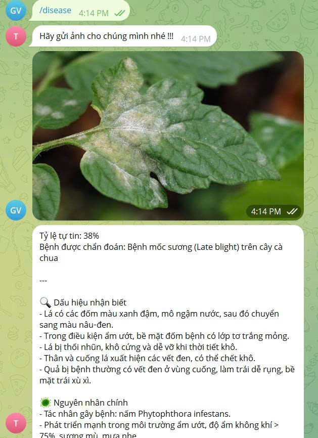
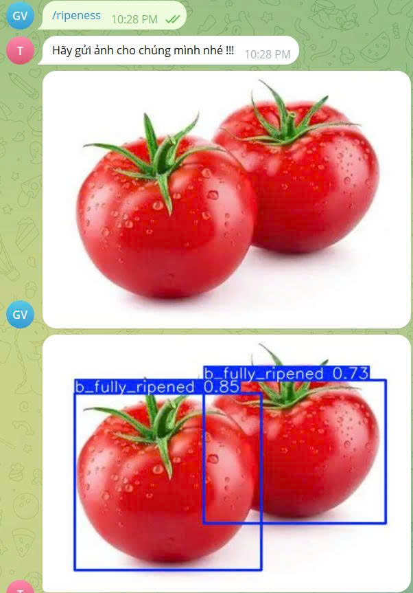
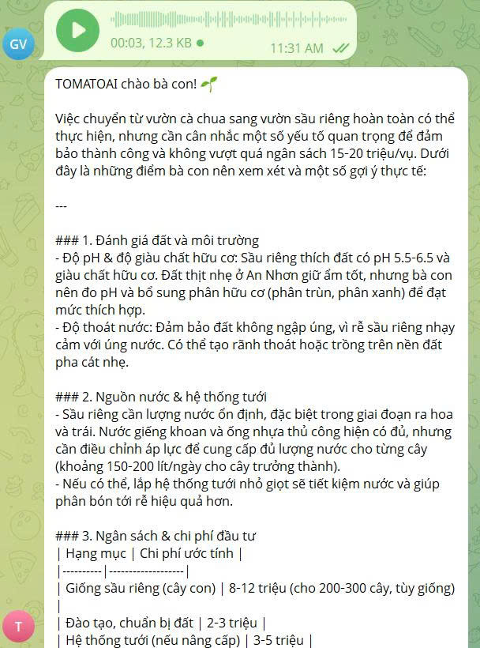
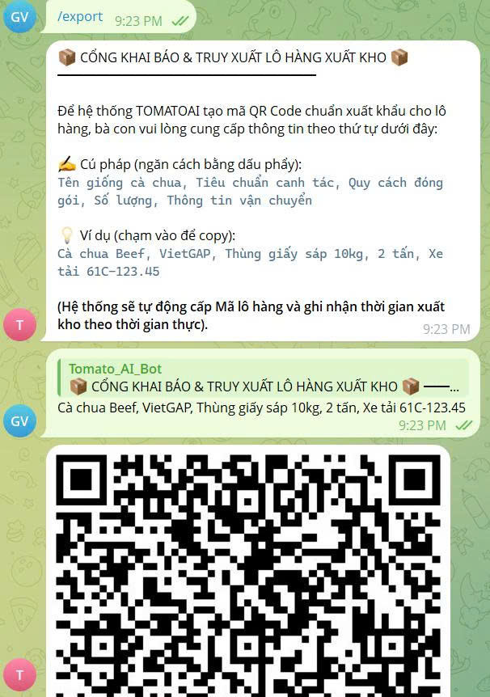
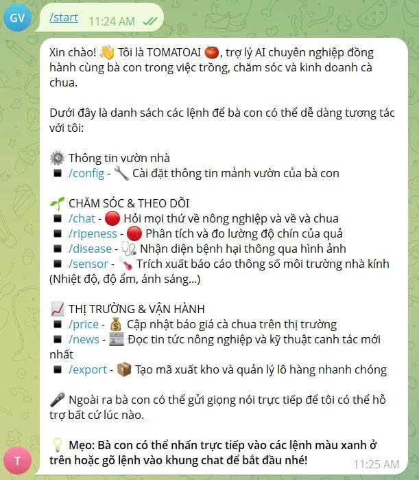
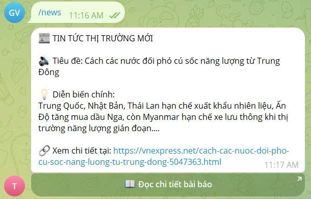
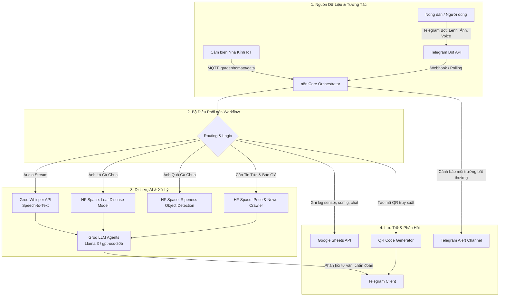
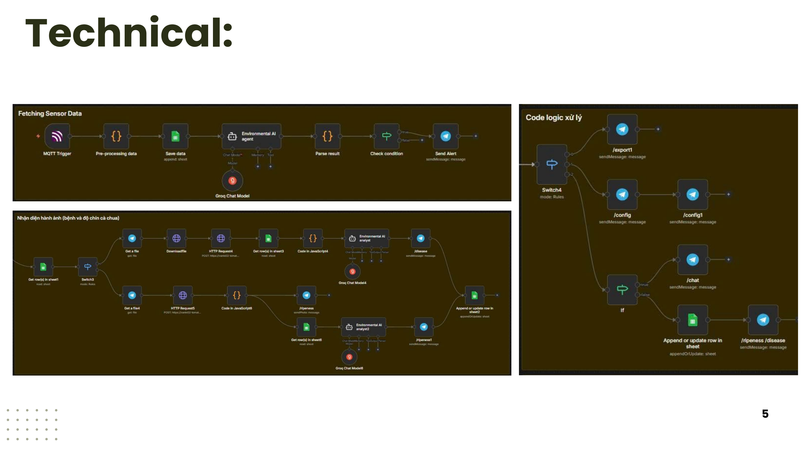

# 🍅 TOMATOAI — Greenhouse Intelligence Platform

> **Định vị dự án:** Đây là **dự án đầu tay (v1 Prototype)** được xây dựng trong khuôn khổ đồ án môn học **Giải pháp AI**. Hệ thống được thiết kế dưới dạng prototype tích hợp giữa **IoT (MQTT) + n8n Workflow Orchestration + Computer Vision + Groq LLMs + Telegram Bot**, chứng minh tính khả thi trong việc hỗ trợ bà con nông dân trồng cà chua nhà kính.

---

## 📑 Mục lục
- [1. Bài toán thực tiễn](#1-bài-toán-thực-tiễn)
- [2. Giải pháp TOMATOAI](#2-giải-pháp-tomatoai)
- [3. Demo kết quả thực tế](#3-demo-kết-quả-thực-tế)
- [4. Kiến trúc hệ thống](#4-kiến-trúc-hệ-thống)
- [5. Ngăn xếp công nghệ (Tech Stack)](#5-ngăn-xếp-công-nghệ-tech-stack)
- [6. Trạng thái các dịch vụ Hugging Face](#6-trạng-thái-các-dịch-vụ-hugging-face)
- [7. Hướng dẫn cài đặt & Chạy lại](#7-hướng-dẫn-cài-đặt--chạy-lại)
- [8. Hạn chế & Định hướng nâng cấp (v2 Roadmap)](#8-hạn-chế--định-hướng-nâng-cấp-v2-roadmap)
- [9. Đội ngũ thực hiện & Tài liệu](#9-đội-ngũ-thực-hiện--tài-liệu)

---

## 1. Bài toán thực tiễn

Trong canh tác cà chua (đặc biệt là mô hình nhà kính công nghệ cao tại Việt Nam), bà con nông dân thường xuyên đối mặt với 4 thách thức lớn:

1. **Chẩn đoán sâu bệnh chậm trễ & thiếu chính xác:** Bệnh mốc sương (*Late Blight* do nấm *Phytophthora infestans*) hay các bệnh đốm lá lây lan cực nhanh. Nhận diện trễ 1–2 ngày có thể làm mất trắng cả vụ thu hoạch.
2. **Khó phản ứng kịp thời với biến động môi trường:** Sự thay đổi nhiệt độ, độ ẩm đột ngột trong nhà kính nếu không được giám sát 24/7 sẽ tạo điều kiện lý tưởng cho nấm bệnh phát sinh.
3. **Rào cản tiếp cận công nghệ khi lao động trực tiếp:** Nông dân đang làm việc tại vườn thường mang găng tay, tay lấm bùn đất, không thuận tiện gõ văn bản trên điện thoại để tra cứu hay nhập liệu.
4. **Thiếu minh bạch chuỗi cung ứng & truy xuất nguồn gốc:** Việc quản lý lô hàng xuất kho và tạo tem truy xuất nguồn gốc thường làm thủ công trên giấy, gây khó khăn khi đưa vào chuỗi siêu thị hoặc xuất khẩu.

---

## 2. Giải pháp TOMATOAI

TOMATOAI được xây dựng như một **trợ lý nông nghiệp toàn diện** hoạt động ngay trên ứng dụng **Telegram**, kết hợp mạng cảm biến IoT và AI:

* 📡 **Giám sát môi trường & Cảnh báo tức thời:** Lắng nghe dữ liệu cảm biến (nhiệt độ, độ ẩm, ánh sáng) qua giao thức MQTT (`garden/tomato/data`). Khi thông số vượt ngưỡng an toàn, hệ thống tự động gửi cảnh báo khẩn cấp về Telegram của chủ vườn.
* 🌿 **Chẩn đoán bệnh trên lá qua hình ảnh (`/disease`):** Nông dân gửi ảnh lá cà chua nghi nhiễm bệnh; mô hình Computer Vision phân tích, phân loại bệnh (kèm % độ tin cậy) và AI Agent hướng dẫn phác đồ điều trị an toàn, sinh học.
* 🍅 **Đánh giá độ chín & hỗ trợ thu hoạch (`/ripeness`):** Nhận diện vị trí và phân loại độ chín của quả (`b_fully_ripened`, ương, xanh) bằng Object Detection, giúp chuẩn hóa chất lượng thu hoạch.
* 🎙️ **Tương tác bằng giọng nói (`/voice`):** Tích hợp Whisper STT, cho phép bà con gửi tin nhắn thoại hỏi đáp kỹ thuật canh tác và nhận câu trả lời tư vấn chi tiết từ AI.
* 📦 **Quản lý xuất kho & Truy xuất nguồn gốc QR (`/export`):** Khai báo thông tin lô hàng (giống cà chua, chuẩn VietGAP, trọng lượng, xe vận chuyển) và tự động tạo mã QR Code chuẩn hóa để dán lên thùng hàng.
* 📈 **Cập nhật tin tức thị trường & Giá cả (`/news`, `/price`):** Tự động thu thập giá cà chua chợ đầu mối và tin tức nông nghiệp mới nhất từ các trang báo uy tín.

---

## 3. Demo kết quả thực tế

Toàn bộ quá trình tương tác diễn ra thân thiện, trực quan trên Telegram Bot:

| Chẩn đoán bệnh lá (`/disease`) | Đánh giá độ chín quả (`/ripeness`) |
| :---: | :---: |
|    *Chẩn đoán bệnh mốc sương (Late Blight) & đề xuất biện pháp xử lý* |    *Phát hiện quả và phân loại độ chín bằng Bounding Box* |

| Tư vấn bằng giọng nói (`/voice`) | Cổng xuất kho & QR Truy xuất (`/export`) |
| :---: | :---: |
|    *Gửi voice note từ vườn và nhận phân tích tài chính/kỹ thuật chuyên sâu* |    *Tạo mã QR Code xuất kho lô hàng theo chuẩn VietGAP* |

| Menu điều khiển (`/start`) | Bản tin thị trường nông nghiệp (`/news`) |
| :---: | :---: |
|    *Bảng menu tính năng đầy đủ cho người làm vườn* |    *Tự động tổng hợp tin thị trường và xuất nhập khẩu nông nghiệp* |

*(Xem thêm ảnh giới thiệu đội ngũ tại [docs/screenshots/08_team_credits.jpg](docs/screenshots/08_team_credits.jpg))*

---

## 4. Kiến trúc hệ thống

Dự án sử dụng **n8n** làm trái tim điều phối (Orchestration Engine), kết nối các dịch vụ rời rạc thành một chu trình khép kín:

### Canvas n8n thực tế:
Sơ đồ n8n chi tiết phân chia thành các sub-flow: *Giám sát Sensor*, *Nhận diện ảnh*, *Tư vấn giọng nói*, *Xuất kho QR*, và *Khởi động Hugging Face*:

---

## 5. Ngăn xếp công nghệ (Tech Stack)

* **Workflow Orchestration:** [n8n](https://n8n.io/) (Low-code workflow automation, điều phối 97 nodes kết hợp JavaScript logic).
* **Giao diện người dùng (Conversational UI):** [Telegram Bot API](https://core.telegram.org/bots/api).
* **LLM & Speech Recognition:** [Groq Cloud](https://groq.com/)
  * Mô hình suy luận: `openai/gpt-oss-20b` & Groq Compound (Llama 3 70B inference tốc độ cao).
  * Chuyển đổi giọng nói: `whisper-large-v3` qua Groq Audio Transcriptions API.
* **Computer Vision & Web Scraping:** [Hugging Face Spaces](https://huggingface.co/spaces) (Triển khai microservices bằng FastAPI):
  * `vanle02-tomatoai-leaf-disease`: Phân loại bệnh hại trên lá cà chua.
  * `vanle02-tomatoai-n8n`: Phát hiện và phân loại độ chín quả cà chua (YOLO).
  * `vanle02-price-news-crawler`: Thu thập giá nông sản và tin tức thị trường.
* **IoT & Giao thức:** MQTT Broker (kết nối dữ liệu cảm biến vườn cà chua qua topic `garden/tomato/data`).
* **Lưu trữ dữ liệu:** [Google Sheets API](https://developers.google.com/sheets/api) (được dùng làm cơ sở dữ liệu lightweight lưu trữ lịch sử chat, log cảm biến và cấu hình vườn).

---

## 6. Trạng thái các dịch vụ Hugging Face

Để đảm bảo tính trung thực và minh bạch của repo:
* ✅ **Chẩn đoán bệnh lá (`vanle02-tomatoai-leaf-disease`):** Dịch vụ đang hoạt động.
* ✅ **Crawler giá & tin tức (`vanle02-price-news-crawler`):** Dịch vụ đang hoạt động.
* ⚠️ **Mô hình độ chín (`vanle02-tomatoai-n8n`):** Không gian Hugging Face Space miễn phí có cơ chế tự động chuyển sang trạng thái Sleep sau một thời gian không có request. Khi gọi API, Space có thể cần 1–2 phút để khởi động lại.

---

## 7. Hướng dẫn cài đặt & Chạy lại

> ℹ️ **Ghi chú kiểm thử:** Workflow được hoàn thiện và kiểm thử lần cuối vào: **Tháng 10/2024**.

Dự án này là một prototype minh họa giải pháp. Nếu bạn muốn import và chạy lại trên môi trường n8n cá nhân:

### Bước 1: Chuẩn bị môi trường & Token
1. Khởi tạo một Telegram Bot qua [@BotFather](https://t.me/BotFather) để lấy `TELEGRAM_BOT_TOKEN`.
2. Đăng ký tài khoản và lấy API Key tại [Groq Cloud Console](https://console.groq.com/).
3. Cấu hình quyền truy cập Google Sheets thông qua OAuth2 trong n8n.
4. Tham khảo mẫu các biến cấu hình tại [.env.example](.env.example).

### Bước 2: Import Workflow vào n8n
1. Mở giao diện n8n của bạn.
2. Chọn **Workflows** > **Import from File...** và chọn file [workflows/tomatoai-workflow.json](workflows/tomatoai-workflow.json).
3. Trong n8n, tiến hành liên kết Credentials:
   * **Telegram API:** Gán token bot vừa tạo.
   * **Groq API:** Gán Groq API Key.
   * **Google Sheets OAuth2:** Kết nối tài khoản Google Drive của bạn và thay thế ID bảng tính mẫu.
   * **MQTT Trigger:** Cấu hình broker và topic `garden/tomato/data`.
4. Nhấn **Save** và kích hoạt (Active) workflow.

---

## 8. Hạn chế & Định hướng nâng cấp (v2 Roadmap)

Với định vị là **v1 Prototype đầu tay**, hệ thống vẫn tồn tại các giới hạn kỹ thuật nhất định. Việc nhìn nhận rõ những hạn chế này là tiền đề quan trọng cho quá trình hoàn thiện chuyên môn:

### Hạn chế của phiên bản v1 (Prototype):
1. **Phụ thuộc vào Low-Code Orchestration (n8n):** Mặc dù n8n giúp ráp nối hệ thống nhanh trong giai đoạn thử nghiệm, nhưng việc duy trì hơn 90 nodes khiến workflow phức tạp, khó viết automated tests (unit test, integration test) và khó quản lý versioning theo chuẩn git flow.
2. **Cơ sở dữ liệu bằng Google Sheets:** Google Sheets tiện lợi để nhóm quan sát dữ liệu nhanh chóng nhưng dễ bị rate-limit của Google API, không tối ưu cho dữ liệu time-series tốc độ cao từ cảm biến IoT và thiếu tính toàn vẹn dữ liệu (ACID).
3. **Chưa có Observability cho LLM:** Chưa theo dõi được token consumption, độ trễ từng bước và chất lượng câu trả lời của agent theo thời gian thực.
4. **Phụ thuộc hạ tầng miễn phí ngoài:** Các Hugging Face Spaces miễn phí dễ rơi vào trạng thái ngủ đông (cold start delay).

### Định hướng kiến trúc nếu xây dựng phiên bản v2 (Production-Ready):
* 🐍 **Backend thuần Python (FastAPI):** Tái cấu trúc toàn bộ luồng xử lý sang microservice backend bằng Python/FastAPI để kiểm soát chặt chẽ memory, async concurrency và dễ dàng CI/CD.
* 🧠 **Điều phối Agent với LangGraph:** Thay thế các node rẽ nhánh thủ công bằng State Machine của **LangGraph**, quản lý bộ nhớ hội thoại nhiều lượt và hỗ trợ human-in-the-loop.
* 📊 **LLM Observability với Langfuse / Traceloop:** Tích hợp tracing để giám sát độ trễ, prompt versions, chi phí token và đánh giá chất lượng câu trả lời (LLM eval).
* 🗄️ **Cơ sở dữ liệu chuyên dụng:** 
  * Sử dụng **TimescaleDB / InfluxDB** cho dữ liệu chuỗi thời gian từ cảm biến.
  * Sử dụng **PostgreSQL** lưu trữ hồ sơ người dùng, lô hàng và **Redis** cho caching.
* 🚀 **Self-hosted Model Serving:** Đóng gói mô hình YOLOv8 và ViT bằng Docker, tối ưu ONNX Runtime / Triton Inference Server triển khai trên cloud độc lập.

---

## 9. Đội ngũ thực hiện & Tài liệu

Dự án được thực hiện bởi nhóm sinh viên thuộc đồ án môn học **Giải pháp AI**:
* 👨‍💻 **Lê Gia Văn** — *Team Lead & Architecture Orchestrator*
* 👩‍💻 **Thư Mai**
* 👨‍💻 **Bá Trọng**
* 👩‍💻 **Hoàng Hiền**
* 👩‍💻 **Quỳnh Hương**

### Tài liệu đính kèm:
* 📄 **Slide thuyết trình chi tiết của dự án:** [docs/TomatoAI-presentation.pdf](docs/TomatoAI-presentation.pdf)
* 📜 **Giấy phép mã nguồn:** Phát hành theo giấy phép [MIT License](LICENSE).
